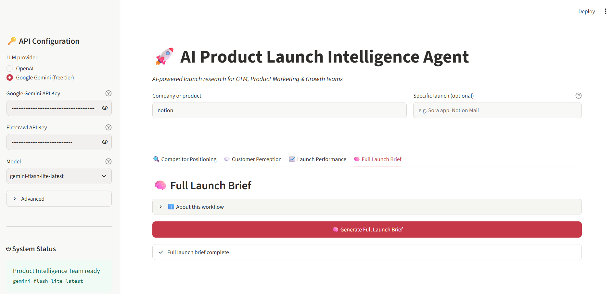
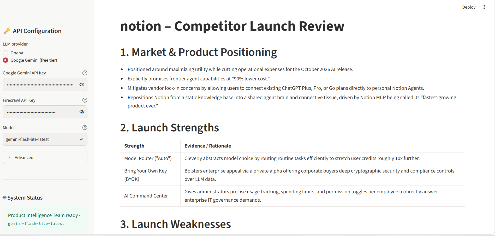

# AI Product Launch Intelligence Agent

A multi-agent product research platform that helps Product Managers and Go-To-Market teams research competitors, understand customer perception, and evaluate product launch performance from public web data.

Built with **Python, Streamlit, Agno, OpenAI and Firecrawl**.

## Key Capabilities

| Workflow | Agent | What you get |
|---|---|---|
| **🔍 Competitor Positioning** | Product Launch Analyst | Positioning, launch strengths & weaknesses with evidence, strategic takeaways |
| **💬 Customer Perception** | Market Sentiment Specialist | Overall sentiment verdict, positive / negative drivers, sentiment by channel |
| **📈 Launch Performance** | Launch Metrics Specialist | Public KPIs table with dates and sources, qualitative signals, performance scorecard |
| **🧠 Full Launch Brief** | Product Intelligence Team | Team leader delegates to all three specialists and synthesises one executive brief |

## How It Works

```
                ┌──────────────────────────────┐
 Company / ───▶ │  Specialist research agent   │ ──▶ tagged, source-linked
 launch         │  (Firecrawl search + scrape) │     evidence bullets
                └──────────────────────────────┘              │
                                                              ▼
                                               ┌──────────────────────────┐
                                               │  Report Writer agent     │ ──▶ structured Markdown
                                               │  (no tools, facts only)  │     report + download
                                               └──────────────────────────┘
```

- **Three specialised workflows.** Each tab runs one specialist agent that searches the web and scrapes the most relevant pages with Firecrawl, then a Report Writer agent turns that evidence into a fixed report structure (tables, scorecards, sources).
- **Coordinated team.** The *Full Launch Brief* uses an Agno `Team` whose leader delegates to all three specialists and synthesises their findings.
- **Grounded output.** Agents are told today's date, must cite every URL they used, and must say when a metric is not publicly available instead of guessing.
- **Structured reports.** Every report can be downloaded as Markdown, individually or all together. The raw research evidence is shown alongside each report.

## Features

- Multi-agent architecture with three specialists, a report writer and a coordinating team
- Optional *specific launch* field to focus research on one product (e.g. "OpenAI" + "Sora app")
- Choice of LLM provider in the sidebar: **OpenAI** or **Google Gemini** (free tier), with a model selector
- On Gemini, the agents automatically fall back to another free model if the selected one is overloaded
- Clear error messages when an API key, model or Firecrawl credit problem occurs
- Results reset automatically when you change the company, so reports never mix subjects
- Keys from `.env`, Streamlit secrets or the sidebar

## Screenshots

### Main Dashboard



### Company Analysis



## Tech Stack

| Layer | Technology |
|---|---|
| **Frontend** | Streamlit |
| **AI Agents** | Agno (Agents + Team) |
| **LLM** | OpenAI (default) or Google Gemini |
| **Web Research** | Firecrawl (search + scrape) |
| **Language** | Python 3.10+ |

## Project Structure

```
├── product_launch_intelligence_agent.py   # Streamlit UI
├── agents.py                              # Agents, team, prompts and workflow runner
├── requirements.txt
├── .env.example
└── assets/                                # Screenshots
```

## Quick Start

1. **Clone** the repository

```bash
git clone https://github.com/pushpitha-j/AI-Product-Launch-Intelligence.git
cd AI-Product-Launch-Intelligence
```

2. **Create a virtual environment and install dependencies**

```bash
python -m venv .venv
source .venv/bin/activate        # Windows: .venv\Scripts\activate
pip install -r requirements.txt
```

3. **Provide API keys** (choose one)

   - **`.env` file:** `cp .env.example .env` (Windows: `copy .env.example .env`) and fill in `FIRECRAWL_API_KEY` plus **one** LLM key:
     - `OPENAI_API_KEY` – needs credit on platform.openai.com, or
     - `GOOGLE_API_KEY` – free key from [Google AI Studio](https://aistudio.google.com)
   - **Sidebar:** paste the keys into the password fields when the app opens
   - **Streamlit Cloud:** add the same keys under *App settings → Secrets*

4. **Run the app**

```bash
streamlit run product_launch_intelligence_agent.py
```

5. Open <http://localhost:8501>.

> **Note:** Live analysis needs a working LLM key (OpenAI with credit, or a free Gemini key) and a Firecrawl key with available credits. On Gemini's free tier, run one workflow at a time to stay within its per-minute limits. A single workflow typically takes 30–90 seconds; the Full Launch Brief takes longer.

## Using the Application

1. Pick the **LLM provider** and enter your **API keys** in the sidebar (or load them from `.env`).
2. Type a **company or product**, and optionally a **specific launch**.
3. Open a tab and click its **Analyze** button. A live status panel shows which agent is working.
4. Read the structured report, expand **Raw research findings** to see the evidence, and **download** the report as Markdown.
